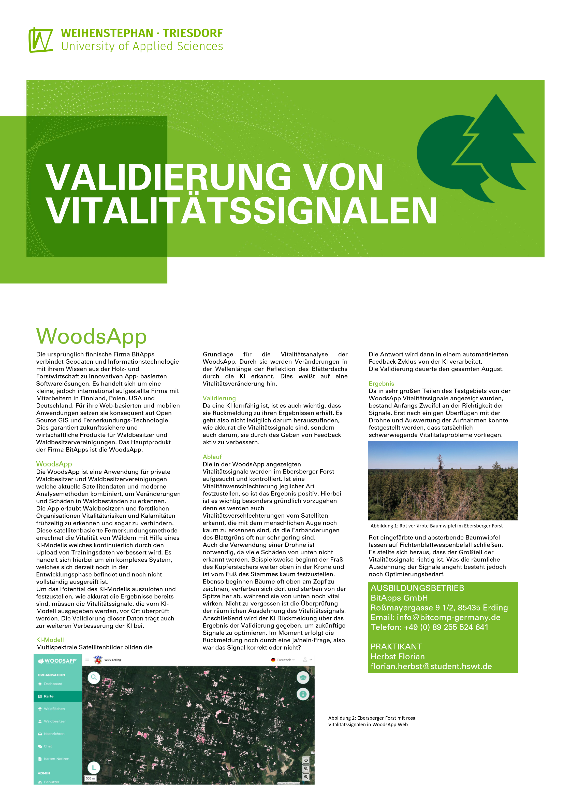

# Validation of AI-Based Satellite Forest Vitality Signals (WoodsApp)


-2D6A4F)


> **B.Eng. Forestry Engineering Practical Internship Project**  
> Hochschule Weihenstephan-Triesdorf (HSWT) & BitApps GmbH (Erding)  
> **Author:** Florian Herbst



---

## Overview

**WoodsApp**—developed by Finnish-German forestry software company **BitApps GmbH** (built on open-source GIS and remote sensing)—combines current **multispectral satellite imagery** with a **self-learning AI model** to alert private forest owners and forestry associations to early-stage canopy vitality loss.

Because early spectral anomalies detected from orbit are often subtle or hidden high in tree crowns, systematic ground and aerial verification is needed both to evaluate real-world detection accuracy and to feed labeled ground-truth back into the AI training loop.

---

## Methodology

1. **Satellite AI Vitality Signal Triage**
   - Inspected polygon-based forest vitality alerts generated by the **WoodsApp** AI model across stands in the **Ebersberger Forst** (Bavaria), flagging spectral reflectance shifts in the tree canopy.

2. **Combined Terrestrial & UAV (Drone) Crown Inspections**
   - Conducted intensive field inspections throughout August.
   - Deployed **UAV (drone) overflights** above the upper canopy—essential because pests such as the six-toothed spruce bark beetle (*Kupferstecher*) and spruce web-spinning sawflies (*Fichtenblattwespen*) cause needle discoloration and dieback starting at the top of the crown, often invisible from the forest floor.

3. **Active AI Feedback Loop**
   - Assessed both the **presence of vitality decline** and the **spatial extent** of flagged polygons.
   - Submitted binary validation feedback (`signal accurate / inaccurate`) directly in WoodsApp to feed the automated model retraining cycle.

---

## Key Results

- **Confirmation of Subtle Upper-Crown Damage:** Initial skepticism caused by the large number of AI alerts was overturned once UAV aerial imagery revealed widespread reddened and dying spruce treetops caused by **spruce web-spinning sawfly (*Fichtenblattwespe*)** infestation across the test area.
- **Model Accuracy & Next Steps:** Verified that the **majority of WoodsApp's AI vitality alerts were accurate**, while identifying concrete **optimization potential in sharpening the spatial extent** of the generated alert polygons.

---

## Tech Stack

- **GeoAI & Earth Observation:** Multispectral Satellite Imagery, Automated ML Feedback Loop
- **Field & Aerial Validation:** UAV / Drone Canopy Inspection, Terrestrial Forest Health Assessment
- **Software:** WoodsApp (Web & Mobile Open-Source GIS Platform)

---

## Repository Structure

```text
woodsapp-ai-forest-vitality-validation/
├── assets/
│   └── poster.png         # High-resolution project poster image
├── docs/
│   └── Poster.pdf         # Printable project poster (German)
├── .gitignore
└── README.md
```

- **Project Poster (PDF):** [`docs/Poster.pdf`](docs/Poster.pdf)
- **Poster Preview (PNG):** [`assets/poster.png`](assets/poster.png)

---

<p align="center">
  Part of the <a href="https://bosquo.github.io/e-portfolio/"><strong>Florian Herbst — Geoinformatics &amp; Forestry e-Portfolio</strong></a>
</p>
